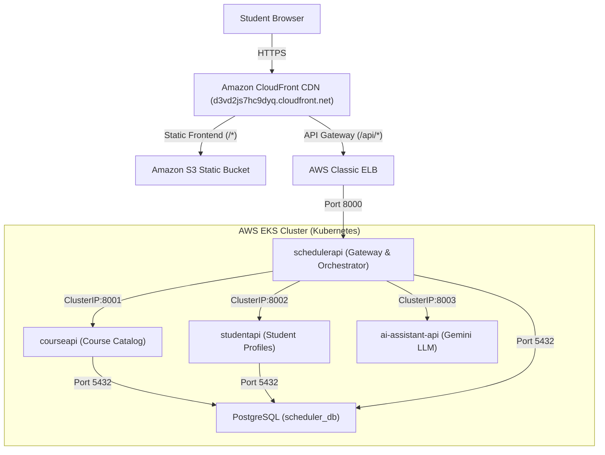

# Smart Course Scheduler (SCS) — Cloud-Native Platform

An enterprise-grade, cloud-native microservices platform for university students that automates academic course scheduling, timetable extraction from images, and complete 7-day work/life balance routine generation.

Hosted on **Amazon EKS** and distributed globally via **Amazon CloudFront CDN** and **Amazon S3**.

---

## Architecture Overview



---

## Repositories & Microservices Directory

| Directory / Repository | Technology | Description |
| :--- | :--- | :--- |
| **[`frontend/`](file:///c:/Users/prosp/Downloads/SCSDev/frontend)** | HTML5, CSS3, JS, S3, CloudFront | Modern responsive Single Page App for course planning and routine calendars. |
| **[`schedulerapi/`](file:///c:/Users/prosp/Downloads/SCSDev/schedulerapi)** | FastAPI, Python 3.12, CSP | Schedule optimization engine & reverse-proxy API Gateway for CloudFront. |
| **[`courseapi/`](file:///c:/Users/prosp/Downloads/SCSDev/courseapi)** | FastAPI, PostgreSQL, SQLAlchemy | University course catalog, sections, prerequisites, and credit allocations. |
| **[`studentapi/`](file:///c:/Users/prosp/Downloads/SCSDev/studentapi)** | FastAPI, PostgreSQL, SQLAlchemy | Student records, academic transcripts, and personal daily routine preferences. |
| **[`ai-assistant-api/`](file:///c:/Users/prosp/Downloads/SCSDev/ai-assistant-api)** | FastAPI, Google Gemini 2.5 Flash | Multimodal vision timetable extraction, schedule analysis, and 7-day routine synthesis. |
| **[`postgres/`](file:///c:/Users/prosp/Downloads/SCSDev/postgres)** | PostgreSQL 16 | Relational persistence schemas across `courses_db`, `students_db`, and `scheduler_db`. |
| **[`infra-terraform/`](file:///c:/Users/prosp/Downloads/SCSDev/infra-terraform)** | Terraform, AWS | Infrastructure as Code provisioning VPC, EKS, Node Groups, S3, CloudFront, and DynamoDB. |
| **[`gitops/`](file:///c:/Users/prosp/Downloads/SCSDev/gitops)** | ArgoCD, Helm, Kubernetes | Declarative GitOps deployment with HPA, PDB, NetworkPolicies, and resource limits. |

---

## Key Platform Capabilities

1. **Multimodal Timetable Vision**:
   - Drag-and-drop timetable images (PNG, JPG, WEBP).
   - Powered by **Google Gemini 2.5 Flash** to extract days, class titles, course IDs, locations, and time slots into editable schedules.
2. **Conflict-Free Course Schedule Optimization**:
   - Solves NP-complete scheduling combinations using a Backtracking Constraint Satisfaction Problem (CSP) algorithm.
   - Enforces credit minimums/maximums and strict time-conflict exclusion.
3. **7-Day Comprehensive Life Routine Planner**:
   - Synthesizes academic courses with personal commute transit, wake-up times, target daily study blocks, gym workout windows, meals, and sleep routines.
4. **Production Reliability & Scalability**:
   - **Horizontal Pod Autoscaling (HPA)** on CPU/memory metrics.
   - **Pod Disruption Budgets (PDB)** ensuring zero downtime during node draining.
   - **Zero-Trust Network Policies** isolating inter-service communication.
   - **AWS Secrets Manager** synchronization for secure database credentials.
   - **Unified CloudFront Origin**: Single domain serving static assets and API routes (`/api/*`) with a 60-second read timeout.

---

## Quick Start (Local Development)

### 1. Launch PostgreSQL
```bash
docker run -d --name scs-db -p 5432:5432 -e POSTGRES_PASSWORD=postgres postgres:16-alpine
```

### 2. Start Services
Each microservice can be run independently using Uvicorn:
- **Scheduler API**: `cd schedulerapi && uvicorn src.main:app --port 8000 --reload`
- **Course API**: `cd courseapi && uvicorn src.main:app --port 8001 --reload`
- **Student API**: `cd studentapi && uvicorn src.main:app --port 8002 --reload`
- **AI Assistant API**: `cd ai-assistant-api && uvicorn src.main:app --port 8003 --reload`

### 3. Open Frontend
Open `frontend/index.html` in your web browser or run `npx serve frontend`.
